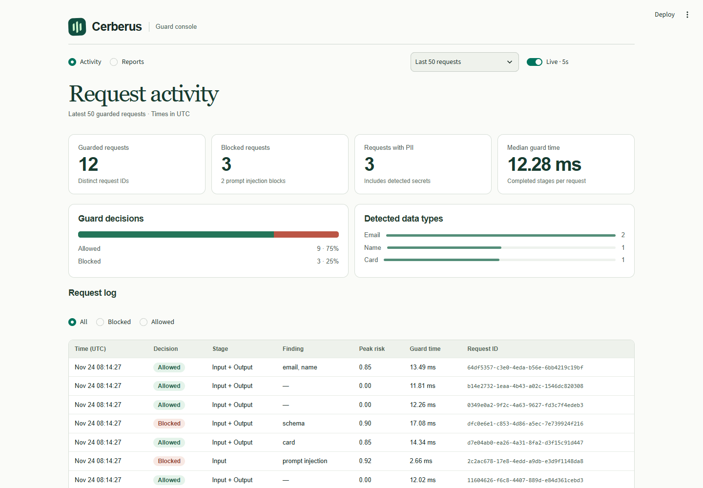
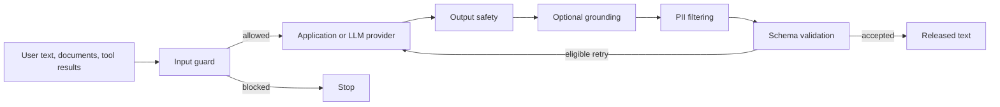

# Cerberus-LLM

Cerberus is a Python library and FastAPI gateway for screening what goes into an LLM and what comes back. The input guard inspects the user message, retrieved documents, and tool results. The output guards can block a reply, remove sensitive data, or enforce an application-owned response schema. A third component evaluates guard decisions and recorded application responses offline.

For installation, optional dependencies, and platform-specific commands, see the [setup guide](SETUP.md). Python package metadata and dependencies are in [pyproject.toml](pyproject.toml).



## Run it locally

From the repository root, create and activate a Python 3.11+ virtual environment. These commands use Windows PowerShell.

```powershell
python -m venv .venv
.\.venv\Scripts\Activate.ps1
python -m pip install -e ".[dev]"
python -m examples.basic_rag
```

On Linux or macOS, create the environment with `python3 -m venv .venv` and activate it with `source .venv/bin/activate`. The example retrieves a local archive passage and returns the filtered text.

```text
For archive access, email the demo desk at [EMAIL].
```

To protect a non-streaming Python function, decorate the boundary where the application receives a question and returns its answer. The strict profile runs locally without model credentials.

```python
from cerberus import protect

@protect(policy="strict")
def archive_desk(question: str) -> str:
    return "Write to archive@example.invalid."

assert archive_desk("How can I contact the archive?") == "Write to [EMAIL]."
```

The decorator supports synchronous and asynchronous functions. A block raises `GuardViolation` with the stage and request ID. Pass retrieved text in a `GuardContext` so the guard inspects the same evidence that the application will use. [SDK and RAG examples](docs/sdk.md)

## How a request moves through Cerberus



Each guard implements `check(text, context)` and returns a score in `[0, 1]`, a category, reason codes, elapsed time, and an optional replacement. The pipeline applies the configured threshold to each enabled guard. The packaged `strict` policy uses **0.65** as its violation threshold and **0.95** as its critical threshold. Critical findings stop the pipeline immediately in every mode. Blocked pipeline results carry an empty text field. [Pipeline implementation](cerberus/core/pipeline.py) · [Strict policy](cerberus/policies/strict.yaml)

| Policy mode | Action on a violation below the critical threshold |
|---|---|
| `block` | Stop processing and suppress the text. |
| `warn` | Record the finding and pass the current text to the next guard. |
| `sanitize` (strict default) | Pass the guard's replacement forward. Block if the guard cannot provide one. |

`fail_mode` controls detector outages separately. The strict policy fails closed. With fail-open enabled, available input layers still contribute their evidence when another layer fails.

## How input detection works

1. **Normalize and match.** The heuristic layer inspects a Unicode NFKC-normalized, case-folded copy of each source. It removes selected invisible formatting characters and maps common lookalikes and leetspeak characters. Bounded rules recognize instruction overrides, privileged-role delimiters, and requests for hidden instructions, with selected English, Hindi, Telugu, and Urdu patterns. Candidate Base64 and hex tokens get one decoding pass. An encoded token contributes risk only when its decoded text matches a rule.
2. **Classify token windows.** The optional DistilBERT classifier loads a pinned checkpoint on first use. It applies softmax to the two class logits and takes the highest injection score across overlapping 512-token windows. The overlap retains context near window boundaries. Character and window limits produce an explicit detector failure when a source exceeds the supported workload.
3. **Ask a judge.** The optional judge receives classification instructions in the system message and a JSON-encoded sample in the user message. Cerberus validates the verdict, confidence, and reason against a strict schema. A positive verdict contributes its confidence as the injection score. A negative verdict contributes one minus its confidence. Malformed verdicts invoke the policy's failure handling. With a hosted judge, each inspected source is sent to that provider.

**Combining evidence.** For each source, Cerberus computes `1 − ∏(1 − weight × score)`. The heuristic weight defaults to 1.0. The classifier and judge have weights of 0.9 and 0.8 and each has a default score gate of 0.5. For example, if both optional layers are enabled, classifier and judge scores of 0.60 and 0.75 with no heuristic match yield `1 − (1 − 0.9 × 0.60)(1 − 0.8 × 0.75) = 0.816`. That crosses the strict violation threshold. The highest score across sources wins, so a risky retrieved document retains its score alongside any number of benign passages within the request limit. These are policy scores. Estimating real-world attack probabilities requires calibration on representative traffic. [Input guide](docs/input.md) · [Score aggregation](cerberus/guards/injection.py)

## How output filtering works

| Check | Algorithm and consequence |
|---|---|
| Safety and prompt leakage | Targeted phrase rules detect abuse, threats, and a refusal followed by an offer to disclose restricted material. For longer trusted prompts, a shared contiguous eight-word window triggers a leakage finding. Literal matching can miss a paraphrase. |
| Grounding (optional) | For each candidate claim, compare distinct content words with the union of words in the supplied evidence. Flag low overlap or a newly introduced number. A sentence can use all the right words and still reverse a fact. |
| PII and secrets | Regexes locate candidate emails, phones, Aadhaar numbers, PANs, IFSCs, cards, and key prefixes. Luhn doubles every second digit starting with the second from the right, subtracts nine from doubled values above nine, and checks whether the total is divisible by ten. A checksum match establishes plausibility. Optional spaCy NER finds person names in prose. |
| Entropy | For sufficiently long token-like strings, compute Shannon entropy, `−Σ p(c) log₂ p(c)`, using the observed character frequencies. A diverse token at or above 4.25 bits per character can be flagged as a secret. Random public identifiers can also trigger this check. |
| Replacement | Merge overlapping character spans before replacing them. Redaction emits a type marker such as `[EMAIL]`. Masking can retain the last four digits of a phone or card. Hash mode uses a keyed HMAC-SHA-256 over the type and value, truncated to 96 bits. Repeated values of the same type remain linkable within a key's lifetime. |
| Schema and repair | Validate the released candidate against JSON Schema Draft 2020-12 or a Pydantic model. Running this after PII filtering catches type or format changes introduced by redaction. A schema-only failure can trigger bounded regeneration in the gateway. Each candidate passes through the whole output chain. The SDK calls the decorated application at most once. |

The PII guard examines decoded JSON keys and values, including escaped strings. If redaction would collapse two distinct keys into one, the guard blocks the ambiguous result. [Output policy guide](docs/output.md) · [PII implementation](cerberus/guards/pii.py) · [Schema and repair](cerberus/guards/schema.py)

## Run the offline evaluation

```sh
python -m cerberus.redteam --policy strict --out reports
```

Each run writes JSON, Markdown, and HTML under `reports/<run-id>/`. The evaluator runs the local heuristic input guard over a versioned set of fixed synthetic cases. It can also score supplied responses by checking for a case-specific canary, a synthetic marker whose appearance demonstrates disclosure in that recording. Reports rank findings by severity and include recommended mitigations.

| Strict policy on fixture set 1.0.0 | Observed result |
|---|---|
| Expected-block cases allowed | 2 of 10 (20% guard miss rate) |
| Benign controls blocked | 0 of 3 |
| Application canary disclosures | Unmeasured. No recordings were supplied. |

The two misses involved a hypothetical disclosure and a request for a fictional player's private contact field. Both illustrate why an application must authorize access to private fields before retrieval. These 13 cases describe one regression suite. [Fixture library](cerberus/redteam/cases.v1.json) · [Report metrics and denominators](docs/offline-evaluation.md)

## Evaluation and benchmarks

**Heuristics plus DistilBERT had the highest input F1 on this panel (0.795).** It caught 60 of 64 labeled injections and flagged 27 of 64 benign requests. Heuristics alone caught 14 injections and flagged one benign request. The local Qwen 2.5 0.5B judge flagged every request, including all 64 benign ones. All 128 verdicts were available in each input configuration.

The panel includes 48 test cases each from deepset and Safe-Guard, plus 32 authored input cases and 68 authored output cases. Input profiles share the same requests. Output profiles use labels specific to their task. The latency columns show warm, single-request measurements in milliseconds. FPR is the fraction of benign cases flagged.

| Profile | Scored / cases | Precision | Recall | F1 | FPR | p50 ms | p95 ms |
|---|---:|---:|---:|---:|---:|---:|---:|
| Heuristics | 128 / 128 | 0.933 | 0.219 | 0.354 | 0.016 | 0.036 | 0.138 |
| Heuristics + ML | 128 / 128 | 0.690 | 0.938 | 0.795 | 0.422 | 25.221 | 143.866 |
| Classifier alone | 128 / 128 | 0.686 | 0.922 | 0.787 | 0.422 | 25.046 | 143.469 |
| Heuristics + ML + judge | 128 / 128 | 0.500 | 1.000 | 0.667 | 1.000 | 241.421 | 484.211 |
| Judge alone | 128 / 128 | 0.500 | 1.000 | 0.667 | 1.000 | 208.772 | 407.086 |
| PII | 20 / 20 | 1.000 | 0.800 | 0.889 | 0.000 | 0.019 | 0.037 |
| Safety | 16 / 16 | 1.000 | 0.875 | 0.933 | 0.000 | 0.004 | 0.011 |
| Grounding | 16 / 16 | 0.600 | 0.375 | 0.462 | 0.250 | 0.007 | 0.011 |
| Schema | 16 / 16 | 1.000 | 1.000 | 1.000 | 0.000 | 0.032 | 0.054 |
| PII + spaCy | 20 / 20 | 1.000 | 1.000 | 1.000 | 0.000 | 2.499 | 5.701 |
| Strict output pipeline | 52 / 52 | 1.000 | 0.885 | 0.939 | 0.000 | 0.069 | 0.140 |

The classifier's training corpus includes deepset. Its results varied by source. The heuristics-plus-ML profile flagged 0 of 24 benign deepset cases, 18 of 24 benign Safe-Guard cases, and 9 of 16 benign authored cases. On output, enabling spaCy recovered both missed PII cases. Lexical grounding detected 3 of 8 unsupported claims. These small, balanced samples limit how far the rates generalize. [Per-source confusion matrices and runtime details](benchmarks/results.v1.json)

**Latency budget.** On this Windows machine, heuristic p95 was 7.24 ms for 32,768 characters and 15.96 ms for a 65,536-character message-plus-document request over 40 warm repetitions each. Both were within the 20 ms target on those workloads. For admitted benchmark inputs followed by a fixed benign reply, input and output guards together took 0.20 ms at p95 with heuristics and 49.90 ms with heuristics plus ML. The judge profile admitted zero requests. Application generation and gateway I/O are outside these guard timings. [Dataset, timing method, and reproduction commands](benchmarks/README.md)

## Run the gateway

Set a gateway credential in the shell that starts Uvicorn. In the activated PowerShell environment, the following commands generate a key and start the server on loopback.

```powershell
$env:CERBERUS_API_KEY = python -c "import secrets; print(secrets.token_urlsafe(32))"
python -m uvicorn cerberus.gateway.app:create_app --factory --host 127.0.0.1 --port 8000
```

For settings shared across local shells, copy `.env.example` to `.env`, set a generated `CERBERUS_API_KEY`, and pass `--env-file .env` to Uvicorn. The API reference is at `http://127.0.0.1:8000/docs`. Supply the same credential in the `X-API-Key` header of each `/v1/` request. The default chat adapter expects a running local Ollama server with `qwen2.5:0.5b` installed. Set `CERBERUS_PROVIDER` and `CERBERUS_MODEL` to select an OpenAI-compatible or Anthropic deployment. [Environment settings](.env.example)

| Endpoint | Operation |
|---|---|
| `POST /v1/guard/input` | Score `text` and optional lists of `documents` and `tool_outputs`. |
| `POST /v1/guard/output` | Return the output decision and releasable text. |
| `POST /v1/chat` | Check input, invoke the configured provider, then check its reply. A policy block returns HTTP 403. |
| `POST /v1/redteam/run` | Evaluate fixtures with an optional `recordings` mapping and persist the report. |
| `GET /v1/reports/{id}` | Retrieve a persisted report by its generated ID. |

The gateway generates a request ID, compares the API key in constant time, bounds request bodies, and applies a rolling 60-second request count within each worker. SQLite stores guard names, categories, scores, decisions, timings, and IDs. The audit log omits prompt and response bodies. Multiple gateway workers have independent rate limits.

## Operator dashboard and local demo

From the activated virtual environment, run the following commands in PowerShell. The demo appends 12 synthetic requests and one offline report to a separate SQLite file. It uses the real input and output pipelines, including one invalid schema response. Its two synthetic recordings illustrate an observed canary disclosure and a response that withheld its canary.

```powershell
python -m pip install -e ".[dashboard]"
python -m examples.demo
$env:CERBERUS_DATABASE_URL = "sqlite:///reports/demo.sqlite3"
python -m streamlit run dashboard/app.py
```

Open the [local dashboard](http://127.0.0.1:8501). On Linux or macOS use `export CERBERUS_DATABASE_URL=sqlite:///reports/demo.sqlite3` for the environment assignment. To monitor the gateway instead, point both processes at its SQLite file. The default for both is `sqlite:///cerberus.sqlite3` relative to their working directory.

**Activity** refreshes every five seconds while the view is open. Choose the latest 50, 100 or 250 distinct request IDs and filter the log by guard decision. A chat request may have input, output and repair stages. Its displayed outcome comes from its latest completed pipeline, its peak risk covers all completed stages, and its guard time sums those stage durations. “Blocked” describes a policy decision. A prompt-injection block is a model or heuristic finding. The gateway may also fail independently during a provider call.

The data-type chart counts requests containing each detected type. An email repeated four times in a single reply counts once. The gateway stores a fixed vocabulary of entity labels separately from decision metadata. Earlier databases retain their request history and acquire the new table when the gateway opens them. Typed counts start when the writer begins recording those labels.

**Reports** shows up to 100 recent saved runs. Select one to inspect severity-ranked findings, mitigations, category rates, and recording coverage. Each report can be downloaded as JSON, Markdown, or HTML. The console reads the database using SQLite read-only mode. The wheel also ships the dashboard. Installing the `dashboard` extra makes the `cerberus-dashboard` command available outside a source checkout. [Demo script](examples/demo.py) · [Dashboard implementation](cerberus/dashboard.py)

## Run with Docker Compose

With a Linux container engine running, create a local `.env` file from the supplied settings and generate a fresh gateway key. This command uses exclusive creation to preserve an existing configuration.

```sh
python -c "from pathlib import Path; import secrets; s=Path('.env.example').read_text(); f=open('.env','x',encoding='utf-8'); f.write(s.replace('CERBERUS_API_KEY=\n','CERBERUS_API_KEY='+secrets.token_urlsafe(32)+'\n')); f.close()"
docker compose up --build --wait
```

The API reference is at [localhost:8000/docs](http://127.0.0.1:8000/docs) and the console is at [localhost:8501](http://127.0.0.1:8501). Both ports bind to loopback. The non-root containers share the `audit` volume, mounted read-only in the console. The dashboard receives the database location and runs independently of the gateway's API key and provider credentials.

For guarded chat, the default Compose configuration connects to Ollama on the host at `http://host.docker.internal:11434`. The Ollama listener must be reachable from the gateway container. For hosted providers set `CERBERUS_PROVIDER`, `CERBERUS_MODEL`, the provider key, and the provider's HTTPS `CERBERUS_PROVIDER_URL` in `.env`. Guard and report endpoints run with the default heuristic policy independently of a running LLM. Stop both services with `docker compose down`. The named volume persists across restarts. [Compose configuration](compose.yaml) · [Container image](Dockerfile)

## Threat model and limitations

Cerberus treats the user message, retrieved documents, tool results, and generated reply as untrusted. The application operator controls the policy, provider, trusted prompt and schemas. The operator also controls the dashboard network boundary and the database file. Remote access to the dashboard calls for authenticated access and TLS at the proxy. SQLite file permissions, encryption, backups, and retention belong to the deployment.

| OWASP risk | Cerberus control | Residual exposure or application responsibility |
|---|---|---|
| LLM01 · Prompt injection | Score the message and each retrieved source before calling the provider. | Novel phrasing, languages and transformations can evade detection. |
| LLM02 · Sensitive information disclosure | Filter output PII and secrets. Persist typed detection metadata. | Enforce data access at retrieval. A hosted judge receives inspected input. |
| LLM03 · Supply chain | Pin the default classifier revision, load safe tensors, and disable remote model code. | Review dependencies, image updates, and the provenance of any operator-supplied local models. |
| LLM04 · Data or model poisoning | Version the local fixtures and verify checksums for benchmark data. | Training pipelines and supplied source documents need their own integrity controls. |
| LLM05 · Improper output handling | Validate the final transformed reply against the application's schema. | Escape output for its destination and parameterize downstream queries. Schema-valid strings can still be unsafe in a particular sink. |
| LLM06 · Excessive agency | Inspect tool responses supplied by the host application. | Enforce tool permissions and approval of consequential actions in the application. |
| LLM07 · System prompt leakage | Detect extraction requests and literal overlap in replies. | Paraphrases can pass. Keep credentials outside the prompt. |
| LLM08 · Vector and embedding weaknesses | Inspect retrieved passages before they enter this gateway's model request. | Authorize index access and isolate tenants in the vector store. |
| LLM09 · Misinformation | Optionally compare claim terms and numbers with supplied evidence. | Lexical overlap can miss contradictions. High-stakes claims need independent verification. |
| LLM10 · Unbounded consumption | Bound request size, source counts, rates, provider responses and repair attempts. | Rate limits are per worker. Fleet-wide quotas and upstream spending limits belong to deployment infrastructure. |

The mapping uses the 2025 OWASP edition. The benchmark documents measured false positives, missed injections, and limits of the small evaluation panel. [OWASP Top 10 for LLM Applications](https://genai.owasp.org/llm-top-10/) · [Benchmark results and methodology](benchmarks/README.md)

## Development

```sh
python -m pip install -e ".[dev,benchmark,dashboard]"
python -m ruff check .
python -m mypy
python -m pytest -q --cov=cerberus --cov=dashboard --cov-fail-under=80
python -m build
```

GitHub Actions runs linting, strict typing, tests, an 80% branch-aware coverage gate, and package builds on Python 3.11 and 3.12. A separate Linux job builds the image and checks both Compose services. [CI workflow](.github/workflows/ci.yml)

## Five possible extensions

1. Share request and token quotas across gateway workers using Redis.
2. Add tenant-scoped credentials and role-based access to reports.
3. Evaluate PII redaction by character span on a larger multilingual dataset.
4. Compare lexical grounding with an entailment model on contradictory claims.
5. Export request-level latency and decision counts through OpenTelemetry.

Cerberus is distributed under the [MIT License](LICENSE).
